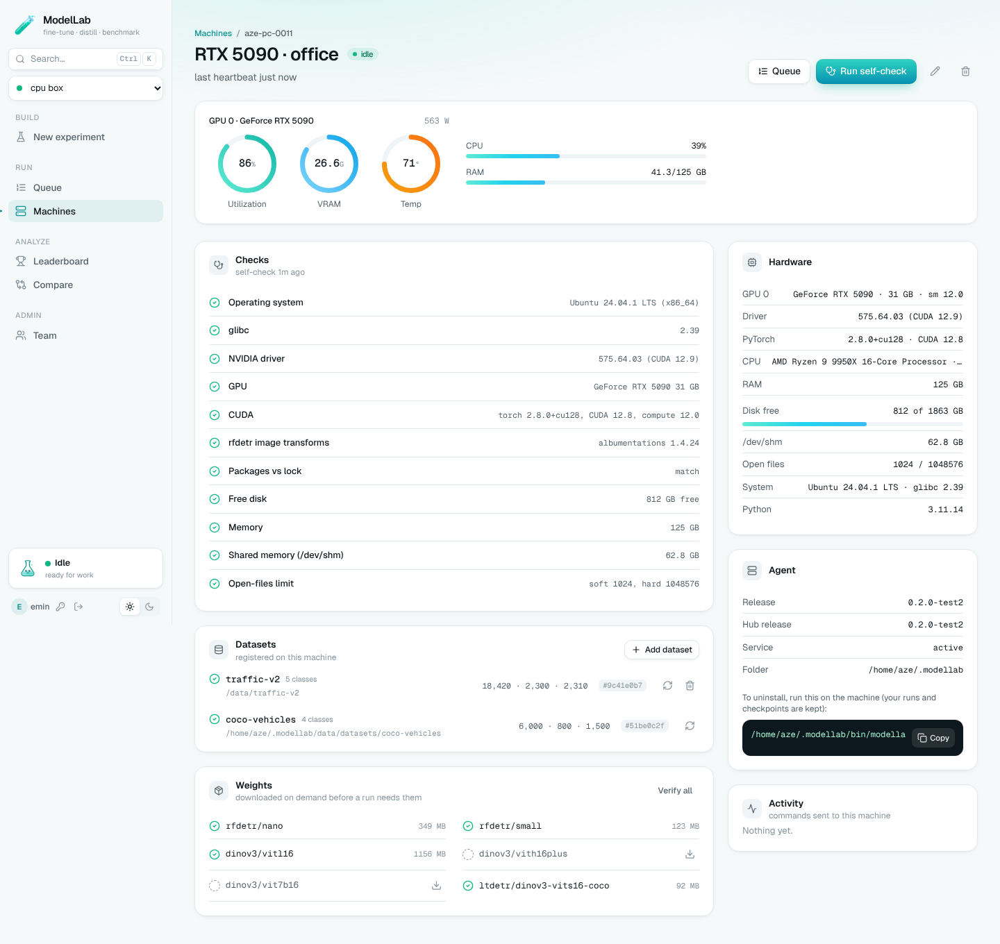
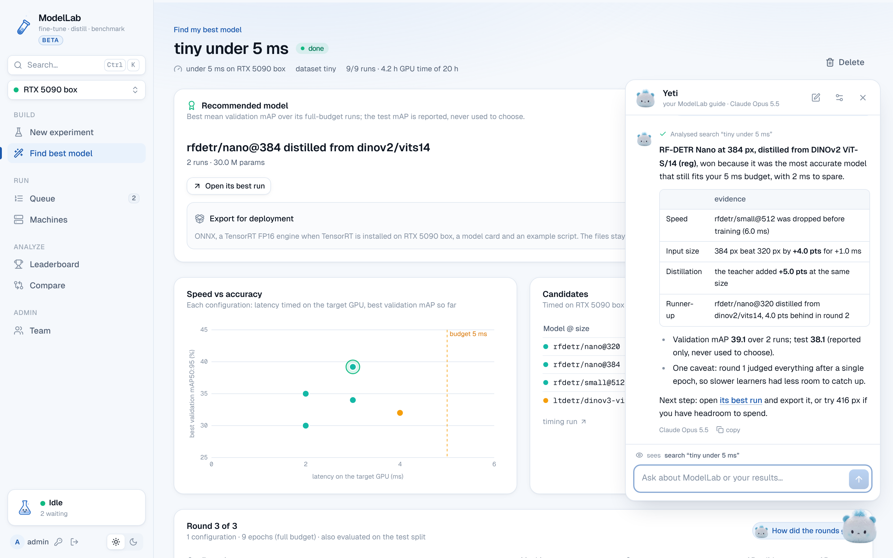

#  ModelLab

A platform for building, training and comparing vision models on your own GPUs.

You describe an experiment in the web app: fine-tune a detector, distill a large teacher into a small model, benchmark
them on your data. It runs on one of your GPU machines, and the results come back to one place where you can rank
and compare them.

ModelLab has three parts:
- **Agents** help you develop: Yeti, the assistant.
- **The harness** is the tools to build and improve models: the engine, your machines, datasets, one evaluation.
- **Loops** run dozens of experiments to find the next breakthrough: Find my best model, for now.

How they fit together: [docs/PLATFORM.md](docs/PLATFORM.md).

Current version: **v0.1** (beta).



## How it works

```
 Browser ──sign in──▶ ModelLab Hub (web app on Railway)
                         ▲
                         │  HTTPS, opened by each PC
           ┌─────────────┴─────────────┐
     GPU PC (RTX 5090)           GPU PC (RTX A4000)
     ModelLab agent              ModelLab agent
```

- **The hub** is the web app your team signs into. It keeps accounts, queues, results and logs.
- **The machine agent** runs on each Linux GPU PC. It trains and evaluates there. Datasets, weights and checkpoints
  never leave the PC.
- **Yeti** is the assistant in the web app. It runs on Claude with your own Claude account and reads (never changes)
  your ModelLab data to answer.
- **Offline mode**: the same app also runs on a single PC without internet (`python app.py`), for air-gapped
  machines.

## What you can do

**Experiments**
- Build experiments from **stages** you chain together: `finetune`, `distill`, `eval`, `features`. A stage can use an
  earlier stage's output, e.g. fine-tune a teacher → distill it into a student → fine-tune → evaluate.
- **Sweeps**: one experiment can expand into many runs (e.g. four teacher sizes).
- Start from **templates** or write the recipe in YAML.
- Models today: RF-DETR (Nano → Large) and LT-DETR detectors, with DINOv2 / DINOv3 teachers (ViT-S up to ViT-7B).

**Find my best model**
- Give ModelLab a dataset, your machines and a speed budget (ms per image on one of your GPUs). It times every
  candidate model and input size first, trains the ones that fit in rounds (the best move on with more epochs),
  repeats the best with other seeds, and recommends the most accurate model that fits.
- Optionally tries learning rates and distilling a DINOv2 / DINOv3 teacher into RF-DETR models. Trials are ordinary
  runs, spread over every machine that holds the same data.
- **Export** the winner (or any fine-tuned model): ONNX, a TensorRT FP16 engine when TensorRT is installed on the
  machine, a model card and a small example script. The files stay on the machine.

**Yeti, the assistant**
- The assistant (Bloom by default, a fluffy white cub with blue ears) in the bottom-right corner, answers questions about ModelLab ("how do I add a machine?") and
  **explains your results**: why a search picked its model (speed headroom, how each round ranked, where a bigger
  model or input size stopped paying off, whether the winner beat the runner-up by more than the seed noise), why a
  run scored what it did or failed, what the PCA and attention figures show, how two runs differ.
- Where there's something to explain, Yeti waves and offers it, and "Explain" buttons sit next to recommendations,
  results, figures, failures and machine checks.
- It runs on Claude, on your own account: paste an API key from your Claude Console account, or add ModelLab as a
  connector in Claude (claude.ai, Claude Desktop, mobile, Claude Code) and use your Claude subscription. Read-only:
  it never changes anything, and never sees datasets, images or checkpoints.



**Results**
- **One evaluation for every model**: same images, same metric code (COCO mAP, per-class AP, latency, VRAM, size).
- **Leaderboard** with the current best model and a speed-vs-accuracy chart; **Compare** up to 4 runs side by side,
  down to the config differences.
- Results are flagged as **not comparable** when the data or evaluation code differs. Datasets are fingerprinted, so
  you can tell two machines hold identical data.

**Machines**
- **Add a machine** with one command pasted into a terminal. No sudo, no manual setup: the agent installs its own
  environment and keeps itself updated.
- **Hardware page** per machine: GPU, driver, memory, disk and live usage. Anything that would break a run shows in
  red, with the fix.
- **Datasets** per machine: browse the PC's folders from the web app to add one (Roboflow, COCO or YOLO), and remove
  it again any time. Files never move. Every dataset is **checked** when added: missing images, broken boxes, unknown
  classes, and images that leak between train, valid and test.
- Live progress and logs; cancel and re-queue. Runs survive a closed browser, and keep training if the hub goes
  down.

**Team**
- Only users an admin adds can sign in; each user runs on their own machines.
- Agent updates are signed, so a PC only accepts code you released.

## Get started

| I want to… | Read |
|---|---|
| Deploy the hub and add my GPU PCs | [docs/HUB.md](docs/HUB.md) |
| Write experiments: recipes, stages, evaluation details | [docs/MODELLAB.md](docs/MODELLAB.md) |
| Run everything on one offline PC | [docs/MODELLAB.md](docs/MODELLAB.md) and [docs/OFFLINE_PIPELINE.md](docs/OFFLINE_PIPELINE.md) |
| See where ModelLab is going: agents, harness and loops | [docs/PLATFORM.md](docs/PLATFORM.md) |

## Roadmap

By part ([how they fit together](docs/PLATFORM.md)):

**Agents: Yeti, hands-on** ([plan](docs/AGENTS_PLAN.md))
- One sentence is enough: a fast System One model picks the component and the action, ModelLab highlights it and
  fills it in, and nothing runs without your approval. Claude plans anything bigger.
- Yeti guides you by highlighting what to click, fixes failed runs, turns your ideas into experiments and searches,
  and finds datasets and models online.

**Harness: the rest of the R&D playground** ([plan](docs/PHASE2_PLAN.md))
- Every major vision model, not only today's detectors: from Hugging Face (`transformers`, `timm`), or your own
  upload.
- Changing the architecture, a core capability: swap backbones and heads, add or change layers, or build a model
  from scratch.
- Hugging Face datasets with a viewer; classification and segmentation.

**Loops**
- Faster and wider searches, failed trials that fix themselves, and research loops where the agent picks the next
  experiments from the last results.

**Notebook**
- The lab's memory: each question with its runs and its answer, including what didn't work, read by you, the agents
  and the loops.

**Phase 3**: cloud GPUs, and clusters (sharing machines with teammates by invitation).

## Repository

| path | what |
|---|---|
| `modellab/` | the engine: recipes, stages, evaluation, datasets, run store |
| `modellab/hub/` | the hosted web app (API, accounts, machines, installer, searches, Yeti + MCP server) |
| `modellab/agent/` | the machine agent on each GPU PC |
| `modellab/web/` | the web UI (React) |
| `recipes/` | experiment templates |
| `tools/mascot/` | the 3D mascots (a furry cub, four plush and a snow golem): how they're drawn and how to add one ([guide](tools/mascot/README.md)) |
| `docs/` | guides and design notes |
| `tests/` | tests (`python -m pytest tests/modellab tests/hub -q`) |
