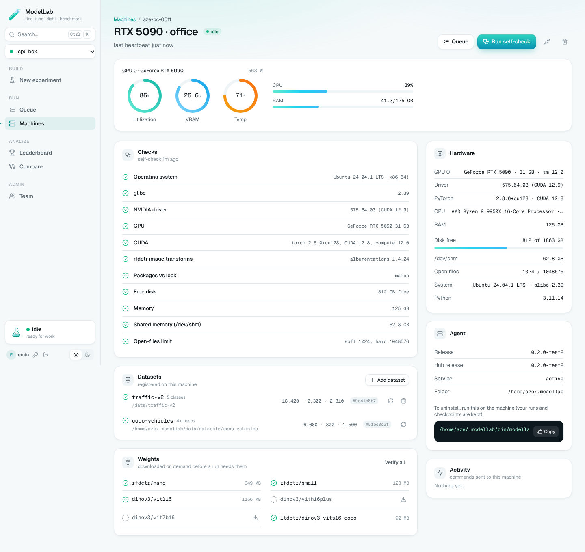

# 🧪 ModelLab

A platform for building, training and comparing vision models on your own GPUs.

You describe an experiment in the web app: fine-tune a detector, distill a large teacher into a small model, benchmark
them on your data. It runs on one of your GPU machines, and the results come back to one place where you can rank
and compare them.



## How it works

```
 Browser ──sign in──▶ ModelLab Hub (web app on Railway)
                         ▲
                         │  HTTPS, opened by each PC
           ┌─────────────┴─────────────┐
     GPU PC (RTX 5090)           GPU PC (RTX A4000)
     ModelLab agent              ModelLab agent
```

- **The hub** is the web app your team signs into. It keeps accounts, queues, results and logs.
- **The agent** runs on each Linux GPU PC. It trains and evaluates there. Datasets, weights and checkpoints never
  leave the PC.
- **Offline mode**: the same app also runs on a single PC without internet (`python app.py`), for air-gapped
  machines.

## What you can do

**Experiments**
- Build experiments from **stages** you chain together: `finetune`, `distill`, `eval`, `features`. A stage can use an
  earlier stage's output, e.g. fine-tune a teacher → distill it into a student → fine-tune → evaluate.
- **Sweeps**: one experiment can expand into many runs (e.g. four teacher sizes).
- Start from **templates** or write the recipe in YAML.
- Models today: RF-DETR (Nano → Large) and LT-DETR detectors, with DINOv2 / DINOv3 teachers (ViT-S up to ViT-7B).

**Results**
- **One evaluation for every model**: same images, same metric code (COCO mAP, per-class AP, latency, VRAM, size).
- **Leaderboard** with the current best model and a speed-vs-accuracy chart; **Compare** up to 4 runs side by side,
  down to the config differences.
- Results are flagged as **not comparable** when the data or evaluation code differs. Datasets are fingerprinted, so
  you can tell two machines hold identical data.

**Machines**
- **Add a machine** with one command pasted into a terminal. No sudo, no manual setup: the agent installs its own
  environment and keeps itself updated.
- **Hardware page** per machine: GPU, driver, memory, disk and live usage. Anything that would break a run shows in
  red, with the fix.
- Live progress and logs; cancel and re-queue. Runs survive a closed browser, and keep training if the hub goes
  down.

**Team**
- Only users an admin adds can sign in; each user runs on their own machines.
- Agent updates are signed, so a PC only accepts code you released.

## Get started

| I want to… | Read |
|---|---|
| Deploy the hub and add my GPU PCs | [docs/HUB.md](docs/HUB.md) |
| Write experiments: recipes, stages, evaluation details | [docs/MODELLAB.md](docs/MODELLAB.md) |
| Run everything on one offline PC | [docs/MODELLAB.md](docs/MODELLAB.md) and [docs/OFFLINE_PIPELINE.md](docs/OFFLINE_PIPELINE.md) |

## Roadmap

- **Clusters**: share machines with teammates by invitation.
- **Model builder**: design or modify your own model architectures and train them like any other model.

## Repository

| path | what |
|---|---|
| `modellab/` | the engine: recipes, stages, evaluation, datasets, run store |
| `modellab/hub/` | the hosted web app (API, accounts, machines, installer) |
| `modellab/agent/` | the agent on each GPU PC |
| `modellab/web/` | the web UI (React) |
| `recipes/` | experiment templates |
| `docs/` | guides and design notes |
| `tests/` | tests (`python -m pytest tests/modellab tests/hub -q`) |
