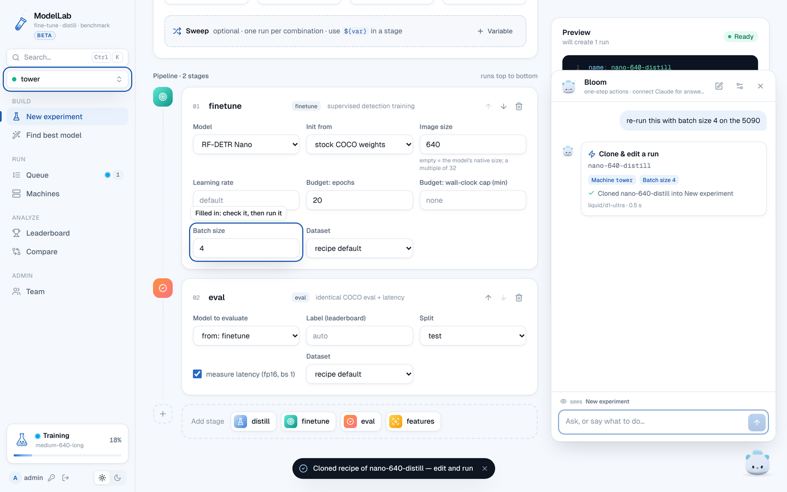
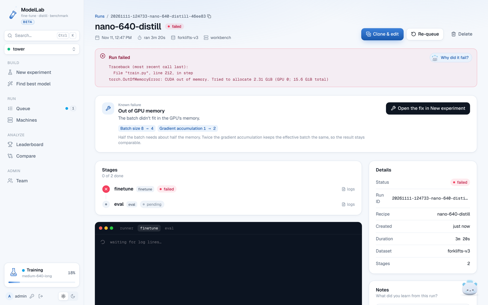

# ModelLab Hub

One web app, hosted on Railway, that pre-registered users sign into. Each user's experiments run on their own Linux GPU
PCs, through a small background program there, the **agent**. The hub holds accounts, the queue, results, logs and
small artifacts. The PCs hold the computation, datasets, weights and checkpoints.

```
Browser ──sign in──▶ Hub on Railway: UI + API + PostgreSQL (users, machines, queue, runs, results, logs, small files)
                          ▲   HTTPS, opened by the agent (no port forwarding, works behind NAT)
              ┌───────────┴────────────┐
     Agent on PC 1 (RTX 5090)    Agent on PC 2 (RTX A4000)
     runs the stages with the same engine as `python app.py`; data, weights and checkpoints stay on the PC
```

The local app (`python app.py`, the offline PC) is unchanged: same engine, same UI, no sign-in.
Design and decisions: [HUB_PLAN.md](HUB_PLAN.md).

| | where | what |
|---|---|---|
| Hub | Railway (`Dockerfile.hub`, `railway.json`) | `modellab/hub/`: FastAPI + PostgreSQL; serves the UI, `/install.sh`, the agent API |
| Agent | each GPU PC, `~/.modellab` | `modellab/agent/`: systemd user service; runs jobs with the existing worker/runner |
| Releases | built and signed in GitHub Actions | `modellab/release.py`, `.github/workflows/agent-release.yml` |

## 1. Deploy the hub (admin, once)

1. **Signing key**, on your own computer (anywhere this repo and `cryptography` are installed):
   ```bash
   python -m modellab.hub release keygen
   ```
   It prints a private key and a public key. Keep the private key in a password manager. It goes into GitHub only, never Railway.
2. **Upload token**: any long random string, e.g. `python -c "import secrets; print(secrets.token_urlsafe(32))"`.
3. **Railway**: New Project → Deploy from GitHub repo → this repository. Railway reads `railway.json` and builds
   `Dockerfile.hub` (Python 3.11, the hub's hash-pinned dependencies from `requirements-hub.lock`, no PyTorch).
4. In the project: **+ New → Database → PostgreSQL**.
5. Service **Variables** of the hub:

   | variable | value |
   |---|---|
   | `DATABASE_URL` | `${{Postgres.DATABASE_URL}}` (the name of your Postgres service) |
   | `MODELLAB_ADMIN_USER` | your username, e.g. `emin` |
   | `MODELLAB_ADMIN_PASSWORD` | a strong password: creates the first admin when the hub has no users yet; ignored afterwards (remove it then) |
   | `MODELLAB_RELEASE_PUBKEY` | the public key from step 1 |
   | `MODELLAB_RELEASE_UPLOAD_TOKEN` | the token from step 2 |
   | `MODELLAB_PUBLIC_URL` | optional: `https://your.custom.domain` (default `https://$RAILWAY_PUBLIC_DOMAIN`) |
   | `MODELLAB_SECRET_KEY` | optional, recommended: any long random string. Encrypts the Claude API keys saved for Yeti (without it, the key that encrypts them is kept in the database) |

6. **Settings → Networking → Generate Domain**, then deploy. `https://<domain>/healthz` answers `{"ok": true}`.
   Keep one replica: login throttling is kept in memory.

## 2. Publish an agent release (admin; again for every update)

Machines install the hub's *current release*, and idle agents update to a newer one by themselves.

GitHub repository → Settings → Secrets and variables → Actions:

| kind | name | value |
|---|---|---|
| secret | `MODELLAB_RELEASE_SIGNING_KEY` | the private key from step 1 |
| secret | `MODELLAB_RELEASE_UPLOAD_TOKEN` | the upload token |
| variable | `MODELLAB_HUB_URL` | `https://<domain>` |

Then Actions → **agent release** → Run workflow, or push a tag `agent-v*`. GitHub only offers "Run workflow" for
workflows on the default branch, so merge this branch first. To publish from your own computer instead:
```bash
MODELLAB_RELEASE_SIGNING_KEY=<private key> python -m modellab.hub release publish --hub https://<domain> --token <upload token>
```
The hub refuses a release whose signature doesn't match `MODELLAB_RELEASE_PUBKEY`. The newest one becomes current.
**Team → Agent releases → Make current** rolls back.

## 3. Users (admin)

**Team → Add user**: the hub shows a temporary password once. The person changes it at their first sign-in.
**Reset password** and **Disable** (signs them out everywhere) are on the same page. There is no sign-up. From a shell with
`DATABASE_URL` set: `python -m modellab.hub users add NAME [--admin]`, `users passwd NAME`, `users disable NAME`, `users list`.

## 4. Add a machine (each user)

Requirements on the PC:
- Linux x86_64 with glibc 2.28 or newer.
- NVIDIA driver 570 or newer. CUDA 12.8 needs it, and so does the RTX 50 series.
- About 15 GB for the Python environment, plus room for weights and checkpoints.
- Outbound HTTPS to the hub, github.com (uv), pypi.org and download.pytorch.org (packages), and the weight hosts
  (`lightly-train-checkpoints.s3…amazonaws.com`, `storage.googleapis.com/rfdetr`, `dl.fbaipublicfiles.com`).
- No sudo.

**Machines → Add machine**, give it a name, and paste the command shown into a terminal on the PC as your normal user:
```bash
curl -fsSL https://<domain>/install.sh | bash -s -- --pair ABCD-2345
```
The code works once, for 10 minutes. The installer:
1. Checks the OS, glibc, driver and disk.
2. Installs uv (pinned version and checksum) and Python 3.11.14.
3. Pairs with the hub.
4. Downloads the current release and checks its SHA-256.
5. Builds the environment from `requirements-agent.lock`, every package hash-checked (a few GB the first time).
6. Verifies the release signature, then installs and starts the `modellab-agent` systemd user service.
7. Runs the self-check.

The machine page fills in as the agent reports.

```
~/.modellab/                    (--dir elsewhere for a bigger disk)
  agent.json                    hub URL, machine id, token (mode 600), release public key pinned at install
  bin/uv, bin/modellab-agent    launcher used by the service
  python/  envs/<lock-hash>/    Python and the environment (shared by releases with the same lock)
  releases/<version>/  current  engine code; weights/ cache/ data/ runs/ link into data/
  data/                         runs/ weights/ cache/ datasets/ datasets.json: kept on update and uninstall
  logs/agent.log
```

On the PC:
- `systemctl --user status modellab-agent` and `journalctl --user -u modellab-agent -f` show the service and its log.
  The log is also in `~/.modellab/logs/agent.log`.
- `~/.modellab/bin/modellab-agent status | doctor | uninstall [--purge]` checks the pairing, runs the self-check, or
  removes the agent. `uninstall` keeps `data/` unless you pass `--purge`.
- The service starts with the PC. If the installer says lingering couldn't be enabled, it stops when you log out;
  `sudo loginctl enable-linger <user>` fixes that.
- `--no-service` skips the service: start it yourself with `~/.modellab/bin/modellab-agent run`.
- Re-run the install command without `--pair` to repair or update an install.
- Behind an HTTP proxy: services don't see your shell's variables. Run `systemctl --user edit modellab-agent`, add
  `[Service]` and `Environment=HTTPS_PROXY=http://proxy:3128`, then `systemctl --user restart modellab-agent`.

**Remove** on the machine page revokes its token. The agent cancels its work and turns its service off.
Runs, checkpoints and weights stay on the PC.

## 5. Datasets

On the machine page, **Add dataset** offers three ways in:
- A folder that is already in Roboflow layout (`train/ valid/ test/`, each with `_annotations.coco.json`).
- A COCO json plus an images folder.
- A YOLO folder.

**Browse** picks the folder (or the `.json`) on that PC: the agent lists its folders for you, marks the ones that
already look like a Roboflow or YOLO dataset, and a picked folder names the dataset. You can still type or paste a
path (`~/…` works). Browsing needs the machine online, with an agent from v0.1 or later.

The last two are split by `make_splits.py` into `~/.modellab/data/datasets/<name>`. Paths are on that PC, and images
are not copied. The agent hashes every image and annotation. If a dataset has the same name and the same hash on two
machines, it holds identical data, and results from those machines are comparable. **Re-check** (↻) after you change
files: it re-hashes and checks the dataset again.

Every add, import and re-check also **checks** the dataset (`modellab.datasets.check`). Problems (red, they block a
search): missing image files, boxes with no area or entirely outside their image, unknown class ids, and the same image
in two splits (evaluation would score images the model trained on). Warnings (amber): boxes partly outside their
image, classes in valid/test that train lacks, very unbalanced classes, tiny valid/test splits, mostly empty training
images. Datasets added before this check show "not checked yet" until you re-check them.

The trash icon removes a dataset from that machine's list (its files stay). Each machine lists only its own datasets:
one whose folder was moved or deleted shows as missing until you remove it or add it again.

## 6. Experiments

Pick a machine in the sidebar. New experiment, Queue and the GPU widget follow it, and **Runs on** sits next to the run
buttons. The recipe is checked against that machine's datasets. Weights it doesn't have yet are downloaded and
hash-checked before the run starts. Each machine runs one job at a time, as before.

The Leaderboard and Compare show results from all your machines. Accuracy is comparable across GPUs; latency is
flagged when it was measured on different devices.

A run page lists checkpoints with their path on the PC; they are never uploaded. Deleting a run can also delete its
files on the machine.

## 7. Find my best model

**Find best model** in the sidebar. Pick a dataset, the machines that train (they must hold the same data: same
fingerprint), the machine whose GPU sets the speed, a speed budget in ms per image, and the models to try (optionally
several input sizes, learning rates and distillation teachers). Then:

1. **Timing**: one run on the speed machine times every model at every input size (`speed` stages, no training).
   Candidates over the budget are dropped.
2. **Rounds**: every configuration that fits trains briefly and is scored on the validation split; the best third
   move on with three times the epochs; the last round trains with the full epochs and also evaluates on the test
   split.
3. **Seeds**: the best two run again with other seeds.
4. **Recommendation**: the configuration with the best mean validation mAP. Its test mAP (mean ± spread) is shown,
   never used to choose.

Trials are ordinary runs tagged `search:<id>`: they show in the queue and on the leaderboard, and spread over the
search's machines. The search moves on by itself when a trial finishes. A GPU-hour cap stops it before a round that
wouldn't fit. Cancelling a search cancels its queued runs.

**Export** (on the recommendation, or on any finished fine-tune stage of a run) runs on the machine that trained it and
writes `runs/<id>/export/<stage>/`: `model.onnx`, `model.engine` (TensorRT FP16, only when `trtexec` is installed on
that PC; it then also reports the TensorRT latency), `preprocess.json`, `infer_onnx.py` and `model_card.md/json`.
Nothing is uploaded; the page shows the folder.

## 8. Yeti, the assistant

The yeti in the bottom-right corner of every page is ModelLab's assistant. It answers how-to questions and explains
results: why a search recommended its model, why a run scored what it did or failed, what PCA and attention figures
show, how two runs differ, what a machine's failing checks mean. Pages with something to explain make Yeti wave once
with a short offer, and "Explain" buttons sit next to recommendations, results, figures, failures and checks.

The assistant is one of six mascots, drawn live in 3D: Bloom (the default), a fluffy white cub with real fur, modelled
on a photo of a plush; four plush ones (Dr. Mochi, Bop, Twinkle and Pip); and Rime, a tall, quiet snow golem with
frost drifting round him. Pick one under **Your assistant** in its settings (saved in that browser). Its look and name change everywhere, and Claude answers as that
character (Rime answers calmly and briefly, and never gushes). How they're drawn: [tools/mascot](../tools/mascot/README.md).

Yeti runs on Claude, with each user's own Claude account. Two ways, set up in Yeti's settings (the sliders icon):

- **Chat in ModelLab**: paste an API key from your Claude Console account (console.anthropic.com → API keys). The
  hub checks it with a free call, stores it encrypted (`MODELLAB_SECRET_KEY`), and never sends it back to the browser.
  Usage is billed to that Console account. Pick the model (Claude Opus 5.5 by default; Sonnet 5.5, Haiku 5.5, Fable
  5.1) and how long it thinks (Quick, Balanced, Thorough).
- **Use a Claude app** (subscription): ModelLab is an MCP server at `https://<domain>/mcp` with OAuth.
  - claude.ai, Claude Desktop or mobile: Settings → Connectors → Add custom connector, paste the address, then
    Connect and approve on the ModelLab page that opens (sign in first if asked).
  - Claude Code: `claude mcp add --transport http modellab https://<domain>/mcp`, then `/mcp` to sign in.
  - Connected apps are listed in Yeti's settings, with Disconnect.

How it works: the hub runs the conversation. Claude asks for data through read-only tools (`modellab/hub/yeti_tools.py`)
that act as the signed-in user: the guide, runs, logs, searches, the leaderboard, comparisons, machines and feature
figures. The comparisons that matter for explanations are computed by ModelLab, not by the model
(`modellab/hub/xai.py`): speed headroom, each round's ranking and cutoff, the gain of each step up in model or input
size with diminishing-returns flags, distillation and learning-rate effects, seed noise and the margin over the
runner-up. The answer streams back with each tool it used, linked to its page.

What Claude sees: only what the tools return when you ask (run, search and machine names, settings, metrics, log
tails, PCA and attention figures). Never datasets, images, annotations or checkpoints. Claude can't start, change or
delete anything.

### One-step actions

Say what to do in one sentence and the assistant does it, usually in under a second, without Claude:

| you say | what happens |
|---|---|
| "re-run this with batch size 4 on the 5090" (on a run's page) | New experiment opens with that run's recipe, batch size 4 and the machine switched, the changed fields ringed. You press Run |
| "open the leaderboard", "open nano-448-dinov3s" | it opens |
| "where do I export this?" | the Export button is ringed; nothing else happens |
| "cancel the queued one" (on the queue) | a card names the run and waits for one tap |
| "delete this run" | a card with "This can't be undone" waits for one tap |
| "why did this fail?" | a question: Claude answers, as before |
| "start a quick test run on the 5090", "halve the batch size and retry" | not one action: Claude looks up what it needs, fills in New experiment and offers a "Queue it" card |

- **Turn it on:** the assistant's settings → One-step actions → paste an OpenRouter key (openrouter.ai → Keys). It is
  stored encrypted, like the Claude key. Without it, every sentence goes to Claude.
- **What decides:** a small decision model (`liquid/d1-ultra`, chosen in [SYSTEM1_EVAL.md](SYSTEM1_EVAL.md)) picks one
  of the actions the page offers; code checks its answer and hands over when it is unsure.
- **What it sees:** your sentence, the page, and the names, statuses and form values on it, all looked up by the hub.
  Never images, annotations, weights or files. OpenRouter and the model's provider receive that request.
- **What it can do:** only what the page's own buttons do, through the same API. Opening and filling in happen at
  once; anything that runs, cancels or deletes waits for your tap. Every decision is logged
  (`GET /api/assistant/actions`). Claude has the same actions and the same limits: it prepares, you tap.
- **⌘K** lists the actions of the page you are on and presses the real button.



### Fixes for known failures

A failed or interrupted run's page shows a card when the failure is one ModelLab knows: what happened, what the fix
changes, and one button.

- **Out of GPU memory:** the button opens New experiment with the run's recipe, half the batch and (on RF-DETR)
  twice the gradient accumulation, so the effective batch stays the same. You press Run.
- **Too many open files, too little shared memory, a driver problem:** it runs the machine's self-check, which shows
  the limit and the command that fixes it.
- **A full disk, a missing dataset folder, missing weights, a NaN loss, an interrupted run:** it opens the machine,
  re-checks the dataset, fetches the weights, halves the learning rate, or re-queues.

An error that matches no pattern is shown to the decision model once (with an OpenRouter key set), and the card then
says "Looks like a known failure". A run started from a fix is tagged `fix:<failure>`; the card says how often that
fix has worked for you. Anything else is for "Why did it fail?", which asks Claude as before.



Next: fixing failed runs, turning ideas into experiments, and finding datasets and models online. Plan and what is
built: [AGENTS_PLAN.md](AGENTS_PLAN.md).

## 9. Updates

Each heartbeat tells the agent the hub's current release. When the agent is idle (no run, no command), it:
1. Downloads the release.
2. Verifies the signature with the key pinned at install, and the tarball hash.
3. Builds a new Python environment only if the lock files changed.
4. Runs a self-test, switches `current` and restarts.

Runs already in progress are never interrupted. A failed update leaves the machine on its release, shows on the
machine page, and is retried within the hour.

## Security

- **Accounts.** Pre-registered only. Passwords are hashed with scrypt.
- **Sessions.** Random tokens stored hashed, in HttpOnly, Secure, SameSite=Lax cookies. They last 30 days and are
  revoked on sign-out, password change and disable.
- **Login throttling.** 5 failures per user or 30 per IP in 15 minutes.
- **Browser protections.** Every state-changing `/api` call needs an `X-ModelLab` header, which cross-site forms
  cannot send. Responses carry a CSP (scripts only from the bundle and the hash of the inline theme script),
  `frame-ancestors 'none'`, nosniff and HSTS.
- **Isolation.** Users only see and command their own machines and runs. A machine token only reaches that machine's
  runs and commands. Pairing codes work once, for 10 minutes. Machine tokens are stored hashed and are revocable.
- **What the hub can make a PC do.** Run recipes, which the agent re-validates with its own code, and a fixed list of
  commands with re-checked arguments (export runs ModelLab's own exporter, and `trtexec` if installed). Never shell
  or code. Searches only queue ordinary recipes.
- **Folder browsing.** For the dataset picker the agent sends folder names, `.json` file names and an image count;
  never file contents, and no hidden entries unless you type such a path. Each listing is logged in
  `~/.modellab/logs/agent.log`. The agent keeps one long-poll open to the hub for this (no port opens on the PC).
- **Updates.** Releases are signed in CI with a key that is not on Railway. Agents refuse anything else, so even
  someone who took over the hub could not push code to an installed PC. A *new* install trusts the hub at install
  time, as any `curl | bash` does.
- **Network on the PC.** Training processes run with `offline_guard`'s network block. Only the agent process talks
  to the network.
- **Yeti.** Claude API keys are encrypted at rest (Fernet; the key comes from `MODELLAB_SECRET_KEY`) and only the
  last 4 characters are shown. Every tool is read-only and scoped to the user. The MCP server accepts only OAuth
  access tokens: dynamic client registration, authorization code with PKCE (S256 only), exact redirect URIs (https,
  or http on localhost for Claude Code), single-use codes, 1-hour access tokens, rotating 30-day refresh tokens (a
  reused one revokes the grant), all stored hashed, and a consent page with a CSRF token.
- **Rotating keys.** The upload token can be replaced at any time: Railway variable plus GitHub secret. A new signing
  key means re-running the install command, with a new `--pair` code, on each machine, because agents pin the key.

## Development

```bash
# hub on SQLite (http only)
MODELLAB_INSECURE_COOKIES=1 MODELLAB_ADMIN_USER=me MODELLAB_ADMIN_PASSWORD=dev-password-1 \
  MODELLAB_RELEASE_PUBKEY=<pub> MODELLAB_RELEASE_UPLOAD_TOKEN=dev python -m modellab.hub serve --port 8790
# an agent from this checkout (no release, never self-updates); --cpu-only on a machine without NVIDIA GPU
python -m modellab.agent pair --hub http://127.0.0.1:8790 --code ABCD-2345 --pubkey <pub>
python -m modellab.agent run
# tests
python -m pytest tests/hub -q                               # hub + agent (no torch needed; SQLite)
MODELLAB_TEST_POSTGRES=1 python -m pytest tests/hub -q      # the same on PostgreSQL (pip install pgserver)
python -m pytest tests/hub/test_e2e.py -q                   # real hub + agent + a tiny CPU run (full environment)
./lock_agent_env.sh                                         # after changing environment.yml pins
```
UI: `cd modellab/web && npm run dev` proxies `/api` to port 8765 (edit `vite.config.ts` to point at a hub); run
`npm run build` and commit `dist/`.

Screenshots: [docs/screenshots/](screenshots/) `hub_*`. The RTX 5090 / A4000 machines in them are simulated through
the agent API, because the sandbox where this was built has no GPU. "cpu box" and "installed box" are real agents. In
`hub_10_yeti_explains` and `hub_11_yeti_mobile`, Claude's answers come from a scripted stand-in fed by the real tool
results (there was no API key in the sandbox).

## What was tested, and what wasn't

Tested in a Linux sandbox without GPU:
- The hub's test suite on SQLite and PostgreSQL 16.
- The hub image layout: `requirements-hub.lock` installed into a fresh Python 3.11 venv with hashes enforced, then
  25 HTTP checks against PostgreSQL.
- The real installer (`curl …/install.sh | bash`), with `--python` pointing at an existing CPU environment.
- Pairing, dataset commands, a weight download before a run, real CPU fine-tune + eval runs, live logs, cancel and
  re-queue.
- 106 s of hub downtime in the middle of a run: the run finished locally and synced afterwards.
- A self-update to a new signed release.
- Refusal of a release signed with another key, placed on the hub as if it had been compromised.
- The UI in light, dark and 390 px, and the local app's UI unchanged.
- v0.1: the dataset picker against a real agent (browse, pick, add a Roboflow folder, import COCO and YOLO, remove a
  dataset whose folder is gone), the old `coco-vehicles` placeholder staying hidden, two users kept apart, and the
  agent's folder browser reconnecting after a hub restart.

- Search, export and dataset check: the search controller with simulated agents on two machines (timing, three
  rounds, seed repeats, recommendation; mismatched data, dataset problems, cancel, isolation) on SQLite and
  PostgreSQL; a real search end to end on CPU (real hub, real agent, `speed` stages, two rounds, a seed repeat, then
  export); ONNX export of both families with the generated `infer_onnx.py` run on a real image; the pages in a
  browser at 1440 px and 390 px.

- Yeti: the tools against seeded searches, runs and machines (user isolation, argument validation), the chat loop with
  the real Claude SDK against a mocked API (streaming, a tool call and its result, the request's caching, effort,
  thinking and fallback settings, history replay, errors), the encrypted key, and the whole OAuth flow into the MCP
  server (registration, consent, PKCE, code reuse, refresh rotation and reuse detection, disconnect). The UI with a
  scripted Claude in a browser at 1440 px (light and dark) and 390 px. Attention maps: recomputed attention matches the
  RF-DETR Nano layer's own output (max error 4e-6), and the features stage wrote them on CPU.

Not tested here; check these on the real machines:
- **Yeti against the real Claude API.** There was no API key here: the requests were checked against the SDK and a
  mocked API. The first real chat is the check (and claude.ai's connector against the deployed hub).
- **TensorRT export.** There is no GPU or `trtexec` here: the engine build and its latency parsing have not run.
- **Search speed on a GPU.** Timing and trials ran on CPU; GPU latency comes from the same code as the eval stage.
- **Building the CUDA environment on a GPU PC.** The full lock resolved with `uv pip install --dry-run` (134
  packages, `torch==2.8.0+cu128`), but nothing downloaded or ran it on a GPU.
- **The systemd user service.** The sandbox has no user systemd. The restart behaviour (exit 75 restarts into a new
  release, 78 stays stopped) ran under a stand-in loop.
- **The Railway build and deploy itself.** There is no Docker here; the image was simulated as described above.
- **The GitHub Actions release workflow.** It needs your secrets.
- **Several users and agents at once over hours**, and Railway's proxy with SSE log streaming.
