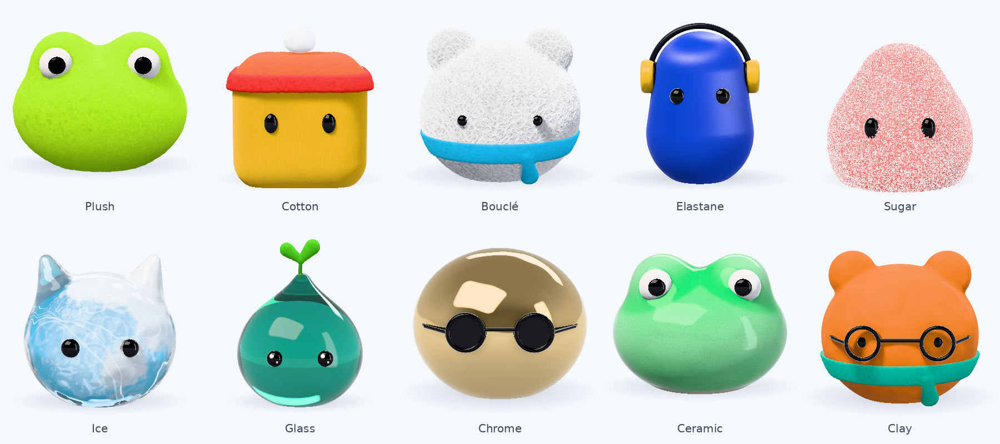

# The materials: what each one is, and how it is drawn

A make-your-own mascot can be made of ten materials. Plush is the pile the mascots started with (see
[tools/mascot/README.md](../tools/mascot/README.md)); the other nine are surfaces, each with a shader of its own in
`modellab/web/src/components/yeti/mascot/materials/`. This page says, for each, what the real thing is, what makes a
picture of it unmistakable, and how the shader gets that. How a material is written and tested is in the mascot
guide.

## What this rests on

- **Cotton was researched in depth.** A research agent read 22 sources and wrote a long report; its findings are
  the cotton section below, and its sources are listed at the end with what was read and what was only seen in
  search results.
- **The other eight were not researched in depth.** The same research was planned for each and was cut off by a
  usage limit before it produced reports. Afterwards the facts and figures in their sections, and the papers they
  name, were looked up one at a time: a web search each, reading the excerpts it returned, not the papers
  themselves. Each section says what that confirmed. How each material looks, and the choices in the shaders, rest
  on general knowledge and were not checked against anything.
- **Every material was judged by eye** on the same set of renders (large, close up, at 68 and 28 px, on the light
  and the dark theme, in white, charcoal, red and mint, with a hat, a scarf and glasses, and from three angles).
  Nothing was compared against photographs side by side.
- **AI viewers were then asked what each was made of, twice.** Each viewer was a fresh instance of the model with
  no knowledge of the work, shown a plain ball of each material (the whole ball and a close-up) with no names.
  They are not people, and a person may judge differently. Two looked before the fixes listed under
  [What the blind checks changed](#what-the-blind-checks-changed) and two others after. Both times one named seven
  of the ten and the other eight, and both times they rated the pictures 4 to 7 out of 10 as photographs. So the
  materials are told apart, most are recognised, and none passes for a photograph. The changes made after the
  second look (to bouclé, elastane and clay) have not been looked at blind.
- **Speed was measured on a software renderer only** (no graphics card). There, one frame of a plain ball at 68 px
  on a 2x screen takes about 56 ms in plush and 25 to 44 ms in the other materials with a look's own program; about
  157 ms and 70 to 131 ms with the shared one.

## Two rules that apply to all of them

1. **At the sizes the app draws, a material is its light, not its texture.** A mascot is a 20 cm toy drawn 28 to
   400 px tall, so one pixel covers 0.3 mm at best and several millimetres usually. A weave, a crystal or a
   fingerprint is smaller than a pixel almost everywhere. What survives is where the highlights sit and how wide
   they are, how the outline and the shadow line look, and whether light gets through. Each shader gets those right
   first; the fine structure is for the editor's preview and anything larger.
2. **Detail smaller than a pixel becomes its average, never noise.** Every fine pattern fades toward its mean tone
   and height as it shrinks (`resolved()` in the library), and sooner where the surface turns away from the eye and
   a pixel covers more of it (`resolvedOn()`). So small mascots are clean, nothing shimmers when they move, and a
   regular pattern does not turn to rings toward the outline.

## Cotton

*Smooth knitted cotton, as on a well-made soft toy.*

- **What tells it apart** (from the research, in order): no highlight at all, so the brightest part of the body is
  still the dye's colour; an even, flat tone across the lit side (a matte cloth ball keeps about three quarters of
  its brightness out to the edge, where a smooth matte ball keeps a fifth); a crisp outline with no halo, which is
  the main difference from plush; shade that gets deeper in colour, not greyer; seams.
- **Close up:** a jersey knit (columns of small V-shaped stitches) that is never ruler-straight, thick and thin
  places in the yarn, an uneven dye, a seam where two panels meet.
- **How:** a rough matte lobe (Oren and Nayar's, in Fujii's form) under a weak pale haze (Estevez and Kulla's
  "Charlie" sheen), and nothing mirrored. The knit is drawn at three times life size so it shows a little sooner, and its
  columns lean and wander. White cotton is 0.93 of white, as bleached cloth is never paper white.
- **Left out:** stray fibres along the outline, lint on dark dyes, puckered hand-sewn seams (the report recommends
  all three).

## Bouclé

*Curly, messy looped cloth: teddy fabric.*

*Looked up:* how the yarn is made. The rest is from memory.

- **The real thing:** an effect yarn is fed faster than the core it is wound round, so the extra length buckles
  into loops, and a third, binder thread holds them. The loops and curls (a few millimetres across: from memory)
  stand off the cloth every which way.
- **What tells it apart:** a nubby outline at any size, speckled shading even when small, deep saturated shade
  between the curls, and softness: no strand has a hard edge.
- **How:** the curls are real relief, so they are in the outline and shade one another. Where a wavy surface in
  space (a warped gyroid) cuts the body, the cut is a curve that wanders and closes on itself like a loop of yarn.
  Three sets of such curves at different scales, one over another, make the tangle (the largest loops are 0.065
  units across, about twice life size); each strand is a rounded ridge along its curve, thick in places and thin in
  others, with a frayed edge and the slanting lines of its plies. The lowest set fills the gaps, so there are no
  dark holes: under yarn there is more yarn. Yarn is full of air, so a strand is shaded by a gentler slope than its true one, and its haze of
  loose fibres glows by the body's slope rather than as a rim on every strand.
- **Left out:** single fibres standing off the strands; the ply and twist of the yarn.

## Elastane

*The stretch fabric of swimwear and athletic wear.*

*Looked up:* what the fibre is (a segmented polyurethane that stretches to four to eight times its length). How
the cloth looks is from memory.

- **The real thing:** a very fine knit of smooth synthetic filaments, pulled taut. No fuzz and no visible weave.
- **What tells it apart:** deep saturated colour with a satin lustre. Smooth fibres lying side by side mirror a lamp
  into a streak that runs across them, so highlights are long soft bands that wrap round the body.
- **How:** an anisotropic GGX lobe laid along the fibres (which run up the body), smooth along a fibre and rough
  across them, partly tinted by the dye; a dark, rich matte base; a tight sheen toward grazing angles; a very fine
  knit in close-up (columns of small loops); lustre that varies a little where the cloth is stretched more. The
  cloth is four panels sewn up the body with flat seams, none down the middle of the face: thread wrapped slantwise
  between two rows of needle holes, with the cloth puckering a little beside it. The seams show on a large mascot
  and fade out on a small one. At the very top, where "up the
  body" has no meaning, the streak fades out.
- **Left out:** the paler tone of cloth stretched thin over a bulge; folds.

## Sugar

*A soft jelly sweet in the body's colour, rolled in coarse sugar.*

*Looked up:* grain sizes (granulated sugar about 0.6 mm, coarse sugar 1 to 3 mm, sanding sugar between), and the
sparkle method's source. Sucrose's index was found in one secondary source only (1.54, which reflects 4.5 %
head-on; the shader uses 4.8 %). The rest is from memory.

- **The real thing:** clear crystals of sucrose about a millimetre across, lying every which way on a translucent
  jelly. Sucrose reflects a little under 5 % of light head-on.
- **What tells it apart:** the rough, frosted outline; pinpoint flashes that come and go as it turns; colour that
  glows between and under the crystals; pale, frosted colour when small.
- **How:** the crystals are real relief: one small brick in each cell of two jittered grids of different sizes,
  turned against each other so no grid shows, each brick turned its own way, with flat faces and sharp sides. A
  crystal is clear: the jelly shows through its top face, its bevelled edges are white, and each is clearer or
  cloudier than the next. Between the big crystals lies fine sugar dust, which is what makes the colour pale and
  frosted and not speckled. A face that mirrors a lamp flashes; where crystals are too small to resolve, grains that fade instead of flickering take
  over (after Wang and Bowles' sparkle), with a few larger ones that still show on a small mascot. The jelly lets
  light creep past the shadow line and glows where a lamp is behind a thin part (thickness is measured through the
  body, as in Barré-Brisebois and Bouchard's translucency).
- **Left out:** light bending inside a crystal; a real crystal shows several faces, where these show one.

## Ice

*A figure carved from real ice.*

*Looked up:* the index (1.310 at 546 nm) and why the middle is cloudy. The rest is from memory.

- **The real thing:** nearly colourless, and it bends light less than glass (index 1.31), so it mirrors little
  head-on and a lot at the edges. Water holds more dissolved air than ice can, and it freezes from the outside in,
  so the air is pushed ahead of the ice and trapped in the middle, which is milky and holds bubbles; stress leaves curved cracks; the surface is rippled by melting, wet, and frosted where it is dry.
- **What tells it apart from glass:** the milky core, the cracks, the frost. Ice has no dye: the body's colour is
  only a blush in the thick parts.
- **How:** a ray is bent at the rippled surface and followed through the body. On the way it gathers the core's
  milk (denser deeper in), the bubbles, and the cracks (curved sheets); what is left of it leaves the far side and
  sees the lamps, a wall or the floor with the mascot's own shadow on it (so what is behind shows through, bent),
  or is trapped and mirrored back. Frost is a rough white layer in patches, with grains that flash. Thin clear
  parts let the page show through.
- **Left out:** bubbles as separate round things (they are a cloudiness that varies), elongated bubble streaks,
  light concentrated on the floor.

## Glass

*Clear coloured glass, blown by hand.*

*Looked up:* the index (soda-lime glass, 1.51 to 1.52). The rest is from memory.

- **The real thing:** no colour on its surface: all of it comes from how much glass the light crossed (Beer and
  Lambert's law), so thick parts are deep and thin parts pale. Index about 1.5.
- **What tells it apart:** sharp reflections of the studio, stronger toward the edges; the scene behind seen bent
  and upside down; dark, rich edges where light is trapped inside.
- **How:** a ray goes in, crosses the body and leaves the far side, or meets the inner surface too flatly and is
  mirrored back for a second crossing. Where it leaves, it sees a lamp, a wall, or the floor with the mascot's own
  shadow on it, so the room shows through bent and upside down: that is what separates glass from jelly. The
  surface wavers very slightly, as hand-blown glass does. A little light is scattered inside in the glass's own
  colour (more of it, and deeper, on the dark theme), which is what keeps the colour on a dark page. Clear parts let
  the page show through.
- **Left out:** colours splitting at the edges, light concentrated on the floor, more than two crossings.

## Chrome

*Mirror-polished metal, tinted by the body's colour.*

*From memory:* nothing here was looked up.

- **The real thing:** a mirror has no look of its own. It is its surroundings, bent round the shape.
- **What tells it apart:** the lamps' panels as crisp bright shapes, a bright floor under a darker room, a dark
  side where the camera stands (a mirror needs something dark to have lines), and the object mirrored in itself.
- **How:** the studio mirrored (see below), and the mascot mirrored in itself once (an ear in the head). The
  surface wavers by a hair, and there is a smudge where the mirror is a little dull. White is silver, yellow is gold, charcoal is black chrome, the rest tinted chrome.
- **Left out:** a second mirroring of itself; the true colour of each metal at grazing angles; scratches from
  polishing (tried twice: at these sizes they read as grain along the edges of the reflections).

## Ceramic

*Glazed stoneware.*

*Looked up:* crazing (a glaze that contracts more than the clay as it cools is stretched over it and cracks) and
breaking (a glaze thins over raised contours and shows a different colour there). That glaze lying thick in hollows
is darker was confirmed; "pooling" as the word for it was not found defined. The rest is from memory.

- **The real thing:** a layer of coloured glass melted onto a matte clay body. Molten glaze runs off bulges and
  edges, where it ends up thin and pale ("breaking"), and gathers in hollows, where it is thick and dark
  ("pooling"). It shrinks more than the clay as it cools, which cracks it finely ("crazing").
- **What tells it apart from plastic:** colour that follows the shape, sharp reflections with a soft falloff over a
  matte colour underneath, and a bare foot where the piece stood in the kiln.
- **How:** the glaze's thickness is worked out from how the body curves (measured from the distance field) and how
  enclosed the spot is; colour goes from pale clay-tinted to deep with thickness. A clear coat mirrors the studio
  over a matte base, on a surface that wavers slightly. Close up there is crazing (the borders of irregular cells)
  and the odd iron speck. The lowest few millimetres are bare, matte clay.
- **Left out:** pinholes; depth inside the glaze.

## Clay

*Modelling clay (plasticine), shaped by hand.*

*Looked up:* what Plasticine is made of (calcium salts, petroleum jelly and fatty acids, which is why it never
dries) and how far apart the ridges of a fingerprint are (0.41 to 0.46 mm on average, so the shader's are about
three and a half times life size). How it looks is from memory.

- **The real thing:** matte with a faint waxy sheen. Light gets a little way into it.
- **What tells it apart:** a soft shadow line that glows slightly, only a broad dull highlight, and a surface that
  was plainly touched: lumps, dents, fingerprints.
- **How:** a matte surface with light wrapping past the shadow line and a little coming back from inside in a
  deeper tone. The surface is uneven at two scales (dents from fingers), with fingerprints in patches where a thumb
  pressed: ridges 0.012 units apart (about three and a half times life size) that arc across the patch and waver, in two sets
  of patches so that one print lies over another. A pressed patch is a little smoother than the rest.
- **Left out:** seams smoothed over where parts were joined; lint, pits and tool marks (tried: they read as flecks
  and stains stuck on).

## What the blind checks changed

Each viewer also said what gave each material away as drawn and not photographed.

**First look.** One viewer named seven of the ten and the other eight. Both took glass for jelly; one took bouclé
for a scouring pad, one took elastane for satin, and one took ice for art glass. Scores out of 10 as a photograph:
ceramic 7, chrome 6, the rest 4 or 5.

| What they said | What was changed |
|---|---|
| Rings (moiré) on cotton, elastane and clay toward the outline | fine patterns now fade by the slant of the surface as well as by size (`resolvedOn()`); the knit is a little larger |
| Glass looked like jelly: the same all through, with nothing seen behind it | the far side now sees the floor, the mascot's shadow and the walls, so the room shows through, bent |
| Sugar crystals were all one size, opaque and without sparkle | more crystals, clear with white edges, tilted so that some flash; fine dust between them (they are still much of a size) |
| Bouclé strands looked melted | steeper strands with less noise on them, and deeper shade between (this made it worse: see below) |
| Ice: the streaks looked painted on | fewer and finer cracks, dimmer; what is behind shows through |
| Chrome: the edges of the reflections were grainy | the scratches that caused it were removed |
| Clay: the flecks looked stuck on, and the one fingerprint was a set of perfect rings | the lint, pits and tool mark were removed; the prints are finer, arc across their patch, waver, and lie over one another |

**Second look**, by two other viewers, after those changes. Again one named seven and the other eight.

| Material | Named, first look | Named, second look | Score, first | Score, second |
|---|---|---|---|---|
| Glass | neither (jelly, jelly) | both | 5, 5 | 5, 7 |
| Cotton | both | both | 4, 4 | 5, 5 |
| Sugar | both | both | 5, 5 | 5, 6 |
| Chrome | both | both | 6, 6 | 6, 6 |
| Clay | both | both | 4, 5 | 4, 4 |
| Ice | one (the other: art glass) | one (the other: a glass marble) | 4, 4 | 4, 4 |
| Elastane | one (the other: satin) | neither (rubber, satin) | 4, 4 | 4, 4 |
| Bouclé | one (the other: a scouring pad) | neither (a scouring pad, twice) | 5, 4 | 4, 4 |
| Plush (not changed) | both | both | 5, 5 | 5, 6 |
| Ceramic (not changed) | both | both | 7, 7 | 7, 7 |

Plush and ceramic were not changed between the two looks and their scores moved by a point at most, so a point is
noise. By that measure the changes fixed glass, may have helped cotton and sugar a little, and did nothing for
ice, clay, elastane or bouclé. Bouclé and elastane got worse at being named.

**After the second look**, the two that neither viewer named were reworked, and clay's prints once more:

- Bouclé (said: thick strands that melt into each other, dark gaps, a sculpted look): loops two thirds the size and
  denser, yarn that is thick and thin with a frayed edge and visible plies, shallower relief, softer shading, and no
  dark holes.
- Elastane (said: it could be rubber or satin, the lines are ruled, nothing says cloth): sewn seams, and a knit of
  small loops in place of ruled lines.
- Clay (said: the prints are too large and too regular): finer ridges that arc and waver.

**These last changes have not been looked at blind.** They were judged by the author's eye only.

Not changed at all: the cracks in the ceramic glaze are all much the same size, plush tufts look flat in close-up,
cotton has no seam in view and its stitches are too regular, the white in the ice reads as a picture on its surface
and not as depth, and the studio that chrome mirrors is plain.

## The studio

Shiny materials need something to mirror. `studio()` in the library is a photographer's set laid out round the
mascot: a large soft key panel in front and above, a tall fill panel to the side, a strip behind for the rim, walls
that are brightest low down and darker on the camera's side, and the floor, which is the page (so it is bright on
the light theme and dark on the dark one). Each panel is as bright as the light its lamp gives a matte surface, so a
mirror and a matte surface agree about the lighting. Rough surfaces see the same set, blurred.

## Sources

**Read for the cotton research** (22 of the 57 the report lists; the rest were seen only in search results or are
from memory, and are in the report, not here):

1. Estevez and Kulla, "Production Friendly Microfacet Sheen BRDF", 2017. https://blog.selfshadow.com/publications/s2017-shading-course/imageworks/s2017_pbs_imageworks_sheen.pdf
2. Sadeghi, Bisker, De Deken, Jensen, "A Practical Microcylinder Appearance Model for Cloth Rendering". https://escholarship.org/uc/item/6v11p5b0
3. Neubelt and Pettineo, "Crafting a Next-Gen Material Pipeline for The Order: 1886", 2013. https://blog.selfshadow.com/publications/s2013-shading-course/rad/s2013_pbs_rad_notes.pdf
4. Burley, "Physically Based Shading at Disney" (from a mirror). https://cgvr.informatik.uni-bremen.de/teaching/cg_literatur/Brent%20Burley%20-%20s2012_pbs_disney_brdf_notes_v3.pdf
5. Filament design document, cloth model. https://google.github.io/filament/Filament.md.html
6. Narkowicz, "Cloth Shading", 2018. https://knarkowicz.wordpress.com/2018/01/04/cloth-shading/
7. Zeltner, Burley, Chiang, "Practical Multiple-Scattering Sheen Using Linearly Transformed Cosines". https://tizianzeltner.com/projects/Zeltner2022Practical/ and https://github.com/tizian/ltc-sheen
8. OpenPBR specification. https://academysoftwarefoundation.github.io/OpenPBR/
9. KHR_materials_sheen. https://github.com/KhronosGroup/glTF/blob/main/extensions/2.0/Khronos/KHR_materials_sheen/README.md
10. MaterialX `mx_microfacet_sheen.glsl`. https://raw.githubusercontent.com/AcademySoftwareFoundation/MaterialX/main/libraries/pbrlib/genglsl/lib/mx_microfacet_sheen.glsl
11. Wang, Jin, Hasan, Yan, "SpongeCake". https://ar5iv.labs.arxiv.org/html/2110.07145
12. Zhu, Jarabo, Aliaga, Yan, Chiang, "A Realistic Surface-based Cloth Rendering Model", supplementary document. https://sites.cs.ucsb.edu/~lingqi/publications/supplementary_sig23cloth.pdf
13. Portsmouth, Kutz, Hill, "EON: A practical energy-preserving rough diffuse BRDF". https://arxiv.org/html/2410.18026
14. Unity HDRP, "Understand fabrics" and `Fabric.hlsl`. https://docs.unity3d.com/Packages/com.unity.render-pipelines.high-definition@17.0/manual/understand-fabrics.html
15. Mitsuba 0.x `irawan.cpp`. https://github.com/mitsuba-renderer/mitsuba/blob/master/src/bsdfs/irawan.cpp
16. Montazeri et al., "A Practical Ply-Based Appearance Modeling for Knitted Fabrics". https://ar5iv.labs.arxiv.org/html/2105.02475
17. Textile School, "Geometrical Modelling of Plain Weft Knitted Fabrics". https://www.textileschool.com/?p=4168
18. "Hairiness in yarn". https://textile-technology.blogspot.com/2008/04/hairiness-in-yarn.html
19. Wikipedia, "Mercerised cotton" and "Poplin". https://en.wikipedia.org/wiki/Mercerised_cotton, https://en.wikipedia.org/wiki/Poplin

**Looked up for the other eight** (one web search each; the excerpts it returned were read, the pages were not
opened in full):

- Ice: Warren, "Optical properties of ice and snow", 2019 (index). https://pmc.ncbi.nlm.nih.gov/articles/PMC6501920 Purdue Materials Engineering, why ice cubes are cloudy. https://engineering.purdue.edu/MSE/AboutUs/GotMaterials/Other/yoder.html
- Bouclé: a study of bouclé yarn's structure. https://link.springer.com/article/10.1007/s40034-021-00225-1 and https://nopr.niscpr.res.in/bitstream/123456789/39053/1/IJFTR%2041%284%29%20367-372.pdf
- Elastane: CAMEO, "Spandex fiber". https://cameo.mfa.org/wiki/Spandex_fiber and https://www.fibersource.com/f-tutor/spandex/
- Glass: soda-lime glass data. https://www.pgo-online.com/intl/soda-lime-glass.html
- Sugar: grain sizes. https://bobsredmill.com/articles/what-is-sanding-sugar Sucrose's index (a secondary source). https://wiki.kidzsearch.com/wiki/Sucrose
- Ceramic: Digitalfire's glossary and trouble-shooting pages. https://digitalfire.com/glossary/breaking+glaze, https://digitalfire.com/trouble/glaze+crazing, https://digitalfire.com/glossary/glaze+fit
- Clay: Wikipedia, "Plasticine". https://en.wikipedia.org/wiki/Plasticine Ridge-to-ridge distance in fingerprints (a 1989 study, from its abstract). https://ojp.gov/ncjrs/virtual-library/abstracts/analysis-ridge-ridge-distance-fingerprints
- Wang and Bowles, "A Robust and Flexible Real-Time Sparkle Effect", 2016. https://diglib.eg.org/bitstream/handle/10.2312/sre20161209/049-054.pdf
- Karis, "Physically Based Shading on Mobile", 2014 (the fit to the split sum that `envBRDF` uses; its constants match). https://www.unrealengine.com/en-US/blog/physically-based-shading-on-mobile
- Barré-Brisebois and Bouchard, "Approximating Translucency for a Fast, Cheap and Convincing Subsurface Scattering Look", 2011. https://ea.com/frostbite/news/approximating-translucency-for-a-fast-cheap-and-convincing-subsurface-scattering-look
- Fujii's variant of Oren and Nayar's model (posted in 2012). https://lists.blender.org/pipermail/bf-cycles/2012-February/000578.html
- Lagarde and de Rousiers, "Moving Frostbite to Physically Based Rendering", 2014 (found; the specular occlusion formula used here was not checked against it). https://blog.selfshadow.com/publications/s2014-shading-course/frostbite/s2014_pbs_frostbite_slides.pdf
- Glints, read about and not implemented: Zirr and Kaplanyan 2016. https://research.nvidia.com/sites/default/files/pubs/2016-02_Real-time-Rendering-of/ZirrKaplanyan_MultiscaleI3D2016.pdf Chermain et al. 2020. https://diglib.eg.org/handle/10.1111/cgf14141 Deliot and Belcour 2023. https://arxiv.org/pdf/2306.05051

**Still named from memory only:** Oren and Nayar 1994; Walter et al. 2007 (GGX); Burley 2012 and Kulla and Conty 2017
(anisotropic GGX); Quilez's articles on distance functions, soft shadows and ambient occlusion; Worley 1996
(cellular noise); Khronos PBR Neutral tone mapping.
