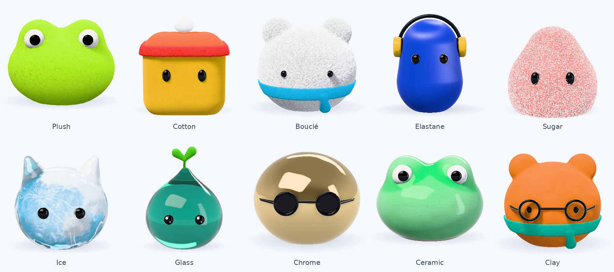

# The mascots

Each of ModelLab's agents has a mascot. It is either Bloom or one the user put together:

- **Bloom** (everyone's first agent): a fluffy white cub with real fur, modelled on a photo of a plush.
- **Make your own:** a shape (pom, bean, drop, gumdrop, cub, frog, tofu, kitten) in a material (plush, cotton,
  bouclé, elastane, sugar, ice, glass, chrome, ceramic, clay) and one of twelve colours, with eyes (bean, round,
  bead, googly, sparkle, smile), glasses (round, shades) and an extra (headphones, beanie, sprout, antenna, scarf,
  cap, tuft). See [Make your own](#make-your-own) and [Materials](#materials) below.

The look is chosen in the agent editor (Chat → the pencil) and kept on the hub with the agent. Claude speaks as the
agent (`MASCOTS` in `modellab/hub/yeti.py` says who Bloom is; `look_words` in `modellab/hub/agents.py` describes a
make-your-own one, material included). Everything is drawn live in the browser from code: there are no images or 3D
model files, except Bloom's small still picture and the editor's samples of the materials, described below.
(The code is still named `yeti`, after the first mascot, which Bloom replaced. Five more built-in mascots, Dr. Mochi,
Bop, Twinkle, Pip and Rime, were removed; a look that names one of them is Bloom.)

| file | what's in it |
|---|---|
| `modellab/web/src/components/yeti/mascot/shaders.ts` | the GLSL: Bloom and the make-your-own mascots as signed distance fields; soft shadows, occlusion, the pile's shading; the two marches |
| `modellab/web/src/components/yeti/mascot/materials/` | one shader per surface material, and `_lib.glsl`, what they share |
| `modellab/web/src/components/yeti/mascot/materials.ts` | the list of those materials |
| `modellab/web/src/components/yeti/mascot/engine.ts` | puts a program together, poses and motion, the shared renderer |
| `modellab/web/src/components/yeti/mascot/looks.ts` | make-your-own mascots: a look becomes lists of parts, each placed on the body |
| `modellab/web/src/components/yeti/mascots.ts` | names, the still picture, the make-your-own options and colours, the agent on screen |
| `modellab/web/src/components/yeti/Yeti.tsx` | the React component: `<Yeti size pose look? kind?>` |
| `modellab/web/src/components/yeti/AgentEditor.tsx` | the editor, with the live preview |
| `tools/mascot/harness/` | renders a material's standard pictures, times it, and makes the editor's samples |
| `docs/MATERIALS.md` | what each material is, what makes it recognisable, how its shader gets that, and sources |

## How it's drawn

- **One renderer.** A page can show many mascots at once (the corner button, the chat header, an avatar on each
  answer, an Explain pill next to each result), but browsers allow only about 16 WebGL contexts. So there is one
  three.js renderer. Each mascot is a `View` with its own scene and a plain 2D canvas. The renderer draws a View, then
  copies the picture onto the View's canvas.
- **One loop.** It runs only the Views that are on screen, each at its own frame rate (15 fps for small ones,
  30 fps for the rest). It stops when none are visible or the tab is hidden. If frames come slowly, every mascot is
  drawn with fewer pixels. With "reduce motion" on, each change draws one still frame.
- **Loaded on demand.** three.js and the shaders are a separate chunk (about 160 KB gzipped), loaded the first time a
  mascot appears. Until then, and where WebGL 2 isn't available, the component shows a still picture
  (`components/yeti/stills/*.webp`).

## The shader, piece by piece

A mascot is a signed distance field, ray-marched in one fragment shader inside a box around it. The engine puts the
shader together from pieces (`program()` in `engine.ts`):

| piece | what it is |
|---|---|
| `COMMON` | uniforms and helpers |
| `BLOOM` or `FUZZY` | the character: Bloom, written out as a shape; or a make-your-own mascot, whose parts are lists |
| `SCENE` | what every program needs: distances, normals, soft shadows (Quilez's penumbra), ambient occlusion from the distance field, the pile's shading, the tone curve (Khronos PBR Neutral) |
| `MAIN_PILE` | the march for a body made of pile: Bloom, and a make-your-own mascot in plush |
| `_lib.glsl`, a material, `MAIN_SURFACE` | the march for a body made of a surface material |

- **A body of pile** is drawn as a volume of fibres (see Bloom, below).
- **A body of a surface material** is a bare surface, grown to where the pile's tips would be so every material is
  the same size. The march finds the point where the eye's ray meets it and asks the material for the light going to
  the eye. What the body wears (a hat, a scarf, a tuft) is still pile, marched in the same loop; eyes, glasses and
  headphones are glossy solid parts, lit by the same studio the materials mirror.
- **Soft edges.** A ray that passes within a pixel of the body or of a solid part without meeting it covers part of
  that pixel, so outlines are smooth. On a bare surface, shadows take finer steps instead of hiding their steps in
  grain, which pile hides and a smooth surface doesn't.
- **Soft studio light:** a big key panel that casts soft shadows, a fill, a rim light, and a white sky dome.
- **Colours** come from ModelLab's ice scale and a bright palette. No purple, pink or indigo (see
  `modellab/web/DESIGN.md`). Bloom is the exception: his colours are the photo's.

## Bloom, the furry cub

Bloom is a round, fluffy white cub with furry sky-blue ears and a tuft of the same long blue fur. He is modelled on
a real object, a photo of a plush. His body is pile, drawn by `MAIN_PILE`.

- **Measured from the photo.** The plush was cut out of the picture, and a camera and a shape (a superellipse of
  revolution with a flat base) were fitted together to its outline and to the centres of the eyes and the mouth, by
  least squares. The outline agrees to about 8 px in the 2000 px photo and the face to about 1 px. The eyes, mouth and
  blush were then taken from the picture back onto that surface, which gives their true size and place, and the ears
  were placed by fitting discs to their blue fronts.
  - His face is laid out on the body's surface (distance round the body, and height). So `eye.x` and the blush's x
    in his spec are distances round the body.
  - The eyes lean outward at the top by about 10°, as they do on the plush.
  - One photo can't tell how far the camera looked down from how low the face sits. The best fit has the camera
    looking down 8°, which is also the app's camera, so in the app he sits as he does in the photo.
- **Colours.** Sampled from the photo part by part (fur in light and in shade, ears, tuft, blush, thread) and checked
  by rendering him with the photo's own camera and comparing the same regions. The photo is exposed so that its white
  fur is a light grey-blue. In the app he sits on a white page, so all the colours are brightened together (×1.37 in
  linear light) until the fur is white. The cool blue the fur takes in its own shade is the photo's too.
- **Fur.** The pile is drawn as a volume of fibres standing off the fabric (Kajiya & Kay 1989), not as a shaded
  surface:
  - A ray is marched to the pile and then through it, a fibre's width at a time. Each fibre it meets covers part of
    the pixel, front to back, until the pixel is covered or the fabric is reached. That gives the soft outline, the
    depth between locks and the fibres over the embroidery's edge without drawing any of them specially.
  - A fibre is a cell of the 3D noise, read at the fibre's root, so the pattern runs along the fibre however it
    leans. It's there where the noise is above a level that rises toward the tip, so fibres taper and differ in
    length. Fibres lean together in locks; a few single ones stand clear of them.
  - Where fibres are smaller than a pixel, the share of the noise above that level is used instead (worked out from
    the noise's measured spread). Small and large views then have the same amount of fur, and nothing shimmers.
  - Direct light thins out with depth in the pile, faster when it comes in low. What the pile stops comes back
    scattered and deeper in colour. Each fibre is lit as a thin cylinder, with a silky highlight, and pale tips glow
    when lit from behind.
  - The studio's shadow is worked out once per pixel, where the fur's surface is, and is never black: fur lets light
    through. The fur casts shadows too, from half-way up the pile.
- **Two furs.** The body's is long and white and lies down, combed away from the crown. The tuft is long, straight
  blue fibres fanning out of a small core on the crown, lying over the head's own fur; its locks differ a lot in
  length, so its outline is ragged. The ears are blue all over, in the tuft's fur cut shorter. (On the plush the ears
  are short nubby pile with a white back; these were asked for instead.)
- **Embroidery.** No pile grows on the stitches, and the pile round them is pulled down, so it lies in a hollow, in the
  shade of the taller fur. The eyes are satin stitch: rows that zigzag, with a border sewn round the edge. The thread
  is a soft black, sampled from the photo. A stitch thinner than a pixel covers only its share of that pixel, so in a
  small view the mouth is a faint line and doesn't run into the eyes.
- **Cost.** A pixel takes about 12 march steps in the corner button and about 20 at 176 px, with two or three fibre
  shadings. Software rendering (no GPU) is slow with fur.
- **Motion.** His ears twitch now and then and the tuft sways. He has no arms, so he wiggles hello.

## Make your own

A make-your-own mascot is short, soft and bright: a body in a material and a pure dye, glossy black eyes, no mouth,
and at most a pair of glasses and one extra. Plush, the first material, is the one OpenAI's dots made familiar
(their press image was the reference for it, and only for it: the characters here are our own, and none of OpenAI's
images are in this repository). The other nine materials are [below](#materials).

- **Plush.** A short plush pile lies in small patches, each combed its own way, a few strands side by
  side. It is drawn with Bloom's fur renderer (`FUR`), with a pile of 0.05 units instead of Bloom's long one:
  - a patch is a cell of a wobbly grid on the fabric, with its own direction;
  - inside a patch the strands are the fibre noise stretched 6.5 times along that direction, bending a little;
  - the strands are of even thickness and end together (a sheared pile), with no stray single fibres;
  - more light gets down into a short, open pile, and what comes back is the dye's own colour, deeper: nothing is
    mixed with white, so a saturated dye stays saturated.
  Measured against the reference's green: its shade, middle and light tones are #95c22c, #afda47 and #cff274; ours
  are #81b31e, #a9dd47 and #c8f17f. Where strands are smaller than a pixel (most sizes in the app) their average is
  drawn, so small views are clean colour with a soft outline.
- **Parts, not shapes.** The other mascots are each written out as a distance function. This one is two lists the
  engine fills in (`FUZZY` in `shaders.ts`): fur parts (the body, a hat, a scarf) and solid parts (eyes, glasses,
  headphones). A part is an ellipsoid, a round cone, a rounded box, a ring, a disc or an arc.
- **One program for all of them, and one of its own for a look that needs it.** The shader that reads any list of
  parts is shared by every look, so a new look is ready at once. It pays for that at every step: a loop, a test of
  each part's kind, and four more readings of the whole shape to find which way is out. `glslFor` in `looks.ts`
  can instead write a look's parts out one after another, each as the kind it is, with which way is out worked out
  by formula alongside the distance. That draws about two and a half times faster and looks the same, but it is a
  program to compile for each look. So:
  - every make-your-own mascot starts on the shared program;
  - when frames come slowly, the loop gives the biggest one on screen a program of its own (`View.specialise`), one
    at a time, and only after that draws everything with fewer pixels;
  - the editor's grid of shapes never switches (`<Yeti thumb>`: eight small pictures, drawn once each).

  The numbers still come from the lists either way, so the eyes can blink and glance. An eye keeps the same parts
  in the same places whatever it is doing (what isn't showing is parked out of sight), so a look's own program
  never changes while it is on screen, and looks with the same kinds of part share one.
- **What it costs to draw.** Measured on the software renderer the tests use, so only good for comparing (a
  graphics card is far faster at all of it, and we have not measured one). One frame at 68 px on a 2x screen:

  | | shared program | its own program |
  |---|---|---|
  | a plain look | 124 ms | 50 ms |
  | with googly eyes and headphones | 126 ms | 50 ms |
  | with sparkle eyes, round glasses and a beanie | 210 ms | 93 ms |

  Bloom takes 71 ms. Getting ready: the shared program takes about 1.4 s once, and then each
  new look 3 to 36 ms; a program of its own takes 0.5 to 1.1 s for each look with different kinds of part. On
  that renderer two mascots side by side had both switched after about 12 s. The two programs draw the same
  picture: across eight looks they differ by 0.1 to 0.4 of a level in 255 on average, and at most 0.6% of pixels
  differ by more than 16 levels (a thin line along a scarf's edge), so a mascot doesn't change when it switches.
- **Two things to keep when changing this code.** A solid part met on the way is lit once, after the march, not
  inside its loop. And the ball that lets the march skip the solid parts is for the march only (`solidNear`): a
  shadow measures how near its ray passes, and takes the ball for something in the light's way, which showed as
  dark creases across the body.
- **Placed by solving.** `looks.ts` has the same distance functions in TypeScript and marches them to find the
  body's surface: where the front is at the eyes' height, how far out the side is, where the top is. Eyes are set
  into the pile there, glasses sit just in front of it with arms that run round the head, headphones span from side
  to side over the top. So every shape takes every pair of eyes, glasses and extra with no table of positions.
- **Hats and scarves are a layer over the body itself** (a part of type 6): the first fur part's own surface,
  thickened between two heights, in knit. A beanie therefore fits a cube of tofu as well as a ball.
- **Solid parts in fur.** The fur path used to draw no solid parts. It now marches them together: a ray that meets
  a glossy eye behind a few fibres draws the eye under those fibres, so the pile closes over an eye's edge.
- **Eyes move.** They are parts too, rebuilt each frame: they blink, turn to stitched arcs for a smile (∩) or for
  sleep (∪), and a googly eye's pupil follows the pointer.
- **Colours.** Twelve dyes (`COLOURS` in `mascots.ts`): the ice blues first, then teal, mint, lime, sun,
  tangerine, coral, cherry, cobalt, snow and ink. No purple or pink, as everywhere in ModelLab.
- **To add a shape, an extra or a colour:** add its parts to `BODIES` or to the extras in `looks.ts`, its name to
  `LOOK_OPTIONS` (and a dye to `COLOURS`) in `mascots.ts`, and the same key to `SHAPES`, `EXTRAS` or `COLOURS` in
  `modellab/hub/agents.py`, which checks a look and describes it to Claude.

## Materials

Cotton, bouclé, elastane, sugar, ice, glass, chrome, ceramic and clay. What each real material is, what makes a
picture of it unmistakable and how its shader gets that is in [docs/MATERIALS.md](../../docs/MATERIALS.md); each
shader also says it in a comment at its top. In short:

| material | what makes it | real relief |
|---|---|---|
| cotton | a matte lobe that stays bright to the edge, a pale haze, no highlight; a knit, a seam | no |
| bouclé | curls of yarn (curves where warped wavy surfaces cut the body), thick and thin, frayed, with more yarn under them | yes |
| elastane | a lustre laid along the fibres, so highlights are long bands round the body; deep colour; sewn seams | no |
| sugar | clear bricks of sugar and fine dust over a jelly that light gets into; faces and grains that flash | yes |
| ice | a ray through the body gathers a milky core, bubbles and cracks; frost; the page shows through | no |
| glass | colour from how much glass the light crossed; light trapped at the edges; the room and the page show through | no |
| chrome | the studio mirrored, and the mascot mirrored in itself; a smudge | no |
| ceramic | a glass coat over glaze that is pale on bulges and deep in hollows; crazing, a bare foot | no |
| clay | matte and a little waxy; dents, fingerprints one over another | no |

On the software renderer each costs less per frame than plush (see docs/MATERIALS.md).

### How a material is written

A material is one file in `mascot/materials/`. `_lib.glsl` in that folder is the contract and the toolbox; read it
first. In short:

- It defines `vec4 matShade(vec3 p, vec3 n, vec3 v, float t)`: the light going to the eye from the point `p` of the
  body (smooth normal `n`, eye direction `v`), and how much of the page behind it hides.
- A header (between `//#header` and `//#body`) may define `MAT_DISPLACE`, with a function `matDisplace(p)`: then
  the body's surface really stands that far above its smooth shape, in outline and shadow. It runs at every step
  near the body, so it has to be cheap.
- The library gives it: a studio to mirror (`studio`, `studioAt`: panels as bright as the lamps), lobes (GGX,
  anisotropic GGX, Fresnel, the split-sum fit), a plain surface to start from (`surf`, `shade`), questions about
  the scene (`occlusion`, `shadowKey`, `curvature`, `thickness`), rays through the body and back at it (`through`,
  `meets`), grains that flash (`glints`), fading by pixel size and by slant (`resolved`, `resolvedOn`, `noiseAt`), and compositing a clear
  thing over the page (`seeThrough`).
- Two rules: at the sizes the app draws, a material is its light, not its texture, so get the lobes right first;
  and detail smaller than a pixel must become its average, never noise.

To add one: write the file, import it in `materials.ts`, add its key to `Material` and `LOOK_OPTIONS.material` in
`mascots.ts` and to `MATERIALS` in `modellab/hub/agents.py` (with the words Claude is told), and run
`swatches.sh` for its sample. A test checks the web app's and the hub's lists agree.

### The harness

`tools/mascot/harness/` draws mascots with the real engine in a headless browser (it needs the web app's dev server,
`npx vite --port 5199 --strictPort` in `modellab/web`, plus playwright and Pillow):

- `mat.sh <material> <folder>`: a material's standard pictures, to judge it by eye. One plain ball, large; four
  looks with eyes, glasses, a hat, a scarf; white, charcoal, red and mint; as small as the app draws it, magnified,
  on both themes; the dark theme; a close-up; three angles. A shader that doesn't compile draws nothing: the
  compiler's error is printed with the line.
- `perf.sh <material>`: one frame's time next to plush, with a look's own program and the shared one.
- `swatches.sh`: the editor's sample of each material (`components/yeti/stills/materials/*.webp`).
- `shot.cjs`, `page.html`: one picture of any looks, with a query string (`looks=<json>`, `size`, `dark=1`,
  `zoom`, `yaw`, `own=1`, `general=1`, `noeyes=1`).

## Changing things

- **A shape, an extra or a colour:** see the end of [Make your own](#make-your-own).
- **A material:** see [How a material is written](#how-a-material-is-written).
- **Bloom:** his shape is `BLOOM` in `shaders.ts` and his spec is in `SPECS` in `engine.ts` (box, camera, face,
  colours, exposure). His still picture (`components/yeti/stills/bloom.webp`, 176 px, transparent) and the OAuth
  consent page's picture (`modellab/hub/yeti.webp`, 160 px) are screenshots of the live mascot.
- **Another built-in mascot:** write its shape as `BLOOM` does (a mascot with pile defines `furM`, the distance to
  the fabric and the pile at a point, and `pileD`, for shadows), add its spec to `SPECS`, and add it to
  `MASCOT_LIST` in `mascots.ts` and to `MASCOTS` in `modellab/hub/yeti.py` (its name, what it looks like, how it
  talks). A test checks the two lists agree.
